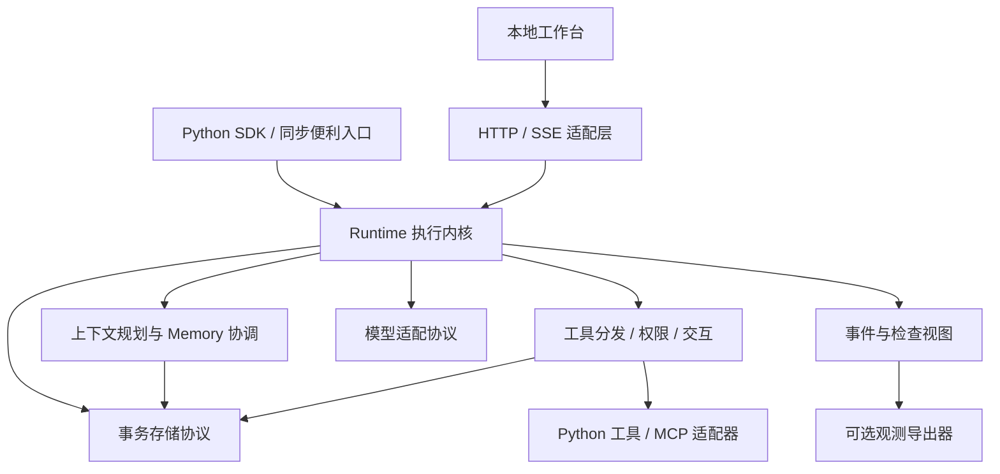

# 架构与模块边界

状态：P4 实施基线，未实现。更新：2026-10-13。

本文定义职责、依赖和数据归属。[行为契约](runtime-contract.md) 是状态、恢复、权限和生命周期规则的唯一详细定义；[API 草案](api-draft.md) 描述用户入口，不能独立改变这些规则。

## 设计决定

采用一个异步运行内核，SDK、流式订阅、HTTP 服务和本地工作台共同使用。Agent 是可复用定义；会话、执行和用户记忆分别存放。首期按单进程持久化运行设计，复杂编排和分布式能力保留扩展边界，不假定已经支持。

依据：[ADR-0002](../decisions/0002-unified-runtime.md)、[ADR-0003](../decisions/0003-context-and-memory.md)、[ADR-0004](../decisions/0004-first-release-engineering.md)、[ADR-0005](../decisions/0005-control-and-observation.md)。具体依赖和文件布局见 [工程方案](engineering.md)。

## 依赖方向

这是逻辑模块图，不承诺每个框都拆成独立软件包。核心不导入 Web 框架、UI、某个模型供应商 SDK 或观测平台；适配器实现核心定义的协议，由应用装配。

## 模块职责

| 模块 | 负责 | 不能隐含承担 |
| --- | --- | --- |
| 公共类型与定义 | Agent、工具 schema、配置、结果、事件和错误 | 全局可变会话或隐式当前用户 |
| Runtime | 运行接收、任务所有权、状态推进、取消、恢复和资源清理 | 任意业务事务的回滚或外部 exactly-once |
| 模型适配 | 能力声明、输入转换、输出/工具调用归一、用量 | 自动放宽权限、悄悄切模型、任意修复结构化输出 |
| 工具分发 | 校验、授权、审批、记录操作意图、执行与结果提交 | 依据模型自述信任工具的安全性 |
| 上下文规划 | 读取明确作用域的数据、预算分配、来源清单 | 跨用户隐式检索或将知识内容提升为控制指令 |
| Memory | 有作用域的存取、版本与删除，参与上下文装配 | 会话历史、整个任务检查点或默认后台总结所有用户 |
| 事务存储 | 原子提交状态/事件/检查点，按归属查询，管理版本 | 包含外部 API 调用的跨系统事务 |
| 检查与观测 | 投影已有事件和上下文清单，可选导出 | 把可丢失的 trace span 当作恢复依据 |
| HTTP / 工作台 | 身份解析、协议转换、展示和交互提交 | 绕过内核策略、单独实现 Agent 循环 |

## 对象和数据归属

| 对象 | 标识与内容 | 归属/生命周期 |
| --- | --- | --- |
| AgentDefinition | name、revision、配置摘要、工具 schema 与能力引用 | 应用注册；修改行为时由开发者更新 revision |
| SessionRecord | tenant_id、user_id、session_id、agent_name、消息与当前未结束运行 | 归属三元组并绑定 Agent 名称，不能只凭 session_id 访问 |
| RunRecord | run_id、Agent 引用、输入、状态、state_version、限额、归属 | 创建后归属固定；被审批者与执行身份不能混淆 |
| Checkpoint | 游标、已提交消息/结果、工具计划、上下文引用、版本 | 和关键状态变化在一个本地事务提交 |
| OperationRecord | operation_id、工具版本、固定参数、执行阶段、结果或不确定性 | 外部动作的证据；不等于外部事务 |
| InteractionRequest | request_id、类型、目标操作/输入 schema、有效期、状态 | 至多一个当前请求/Run；响应以条件更新方式消费 |
| EventRecord | run_id、seq、事件类型、版本、载荷或内容引用 | 持久化事实；用于增量投影与定位 |
| ContextManifest | model_call_id、输入组成、来源、用量估算、选入/处理结果 | 每次模型调用一个已确定输入的清单 |
| MemoryRecord | tenant_id、user_id、agent_name、key、version、来源与内容 | 首期默认用户在该 Agent 下的记忆；不自动共享到其他 Agent |
| DataTombstone / RestoreBarrier | 已清理记录的去重/不可恢复标记；恢复旧备份的核查标记 | 显式离线维护所有；保留最小事实，不把清理或回滚备份当作重新执行授权 |

RunContext 中的凭据、连接和服务对象不序列化。存储只保留可验证的身份标识和非秘密配置引用，恢复时从应用重新解析依赖和当前权限。

## 注册与版本

- 持久化 Runtime 接收 `agents=[...]` 注册定义，按 `(name, revision)` 查找。开始运行还保存可规范序列化的配置/schema 指纹。
- 定义指纹不能可靠反映任意 Python 函数体变化，开发者必须更新 revision；这一要求已纳入发布检查。
- 恢复需要原 Agent revision 和兼容的记录 schema。缺失时返回明确冲突，不用新版本猜测如何继续，不执行工具。
- 同一 Session 绑定 agent_name；提交其他 Agent 返回冲突。新 Run 可以显式选择同名的新 revision，但必须兼容会话记录 schema；活动 Run 始终使用自己的原 revision。
- 用户运行数据属于原身份；本次审批人另记为响应者。恢复权限重新查询，过期 token 不从数据库复活。
- 版本不匹配仍允许按兼容的只读记录查看问题；迁移是显式操作，不在请求中隐式改写旧数据。

## 运行拓扑

首期支持一个 Runtime 进程拥有一个持久化存储。采用 portalocker 本地排他锁、同进程登记和单 aiosqlite 连接；重复打开同一存储必须失败。路径限制、事务调度和锁释放规则见工程方案；具体跨平台行为待 T-03/T-10 验证，不用“数据库能处理并发写入”代替这一约束。

同一 Runtime 可运行不同会话；同一会话同时只能存在一个未结束的 Run。普通人工等待不占执行线程或模型连接，但暂停仍占据会话位置；未知操作中尚未停止的旧调用仍占用资源及容量，不能提前释放。新输入先使原运行安全终结，或者创建新会话。

P2 采用顺序工具执行。同一模型输出多个调用时，先保存完整计划，再按顺序执行；第一个暂停阻止剩余调用继续。这样先把可解释性、检查点和审批规则建立清楚。并行调度后续作为显式策略加入。

## 资源装配

持久化存储和内置 Memory 使用运行时资源描述，不在模块导入时打开连接。Runtime 进入异步上下文时装配所需资源，失败时逆序释放已成功创建的资源。

- Drov 从描述创建的连接由 Drov 关闭。
- 应用传入的现有客户端默认为借用，不会被 Drov 关闭；转交所有权必须显式声明。
- 工具依赖通过应用提供的依赖解析器获得；核心不持久化闭包、连接池或授权 token。
- 应用拥有的借用资源必须活得足够久；Runtime 的 borrowed/owned 约定需要对应适配器的一致性测试。

正常关闭、强制取消和无法及时结束的同步工具行为见 [行为契约](runtime-contract.md)。关闭失败不得被包装成“全部资源已安全释放”。

## 后续最小多 Agent 组合边界

P2 选定一种候选：单个父 Run 顺序委派到同一 Runtime 中注册的子 Agent，形成有 parent_run_id 的子 Run。P3 决定不进入 v0.1，保留为 v0.2 候选；下面不是首期实现承诺，不创建空 delegate API。

- 父子使用同一事务存储，创建子运行和保存父子关联必须原子提交。
- 子运行使用独立内部会话，不占父会话的位置；默认只收到显式任务输入，不复制全部历史、记忆或凭据。
- 有效权限不超过父调用者权限、委派范围和子策略的交集。根运行统一累计子调用用量、工具次数和深度限额。
- 父 Run 等待子 Run 时仍是 running 的内部等待阶段；子 Run 需要人工输入时父 Run 变为 suspended，展示指向子请求的引用，不复制出第二个可消费请求。
- 对根运行的交互响应按保存的委派关联路由到子请求，授权在真实子请求上再校验；子请求完成后才推进父运行。
- 取消沿关联传播；结果不确定时父运行仍必须展示待核查状态。恢复使用已记录子 run_id，不重新生成另一份子任务。
- 首个实现如纳入只支持一级、顺序委派；任意图编排、动态团队、分布式子 Agent 和共享可变记忆均不在这个最小契约内。

## 扩展边界与实施接点

模型、工具、存储、权限解析、Memory 和观测导出器的首期开放程度、支持字段及一致性测试在工程方案/API/质量计划落定。存储和外部 Memory 扩展协议暂不承诺稳定。扩展不能绕过工具授权/检查点；观察型回调不能直接改写运行状态，转换型扩展只能在规定的上下文装配阶段运行。

P3 已确定最低 Python、schema 子集、SQLite/Memory、首个模型与 MCP 传输、包结构、默认限额和模块任务。P4 已检查三个场景与任务的一致性；T-01/T-02 用实际依赖解析和类型定义验证选择。
