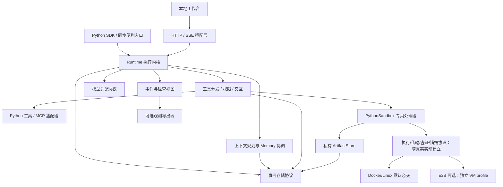

# 架构与模块边界

状态：P4 实施基线；T-02 至 T-08 已实现定义/协议、事务存储、Runtime 注册/资源、只读 Agent、上下文选择/清单和内置事务 Memory；T-09 审批/输入子范围已实现；T-09 已接入外部未知效果/显式恢复；T-10A 文件/代码沙箱闭环已接通；HTTP按ADR-0025接入，工作台尚未实施。更新：2026-10-15。

本文定义职责、依赖和数据归属。[行为契约](runtime-contract.md) 是状态、恢复、权限和生命周期规则的唯一详细定义；[API 草案](api-draft.md) 描述用户入口，不能独立改变这些规则。

## 设计决定

采用一个异步运行内核，SDK、流式订阅、HTTP 服务和本地工作台共同使用。Agent 是可复用定义；会话、执行和用户记忆分别存放。首期按单进程持久化运行设计，复杂编排和分布式能力保留扩展边界，不假定已经支持。

依据：[ADR-0002](../decisions/0002-unified-runtime.md)、[ADR-0003](../decisions/0003-context-and-memory.md)、[ADR-0004](../decisions/0004-first-release-engineering.md)、[ADR-0005](../decisions/0005-control-and-observation.md)。具体依赖和文件布局见 [工程方案](engineering.md)。

T-09 的 InteractionController 归 Runtime，负责保存的原计划暂停、到期和响应消费；ToolDispatcher/MemoryDispatcher 仍各自执行实际操作，批准不能把外部写入变成 Memory 事务。HumanInput 是注册描述，响应由内核写成原操作结果；无需保存/恢复 Python 函数栈。interaction 保存请求与 operation/配置绑定，receipt 保存不可变响应及可信响应者；检查点引用原 model_response 和 operation_ids。同 tenant 的私有归属定位只用于经 Authorizer 检查的查看/控制，数据读取和继续执行使用原 owner。见 [ADR-0014](../decisions/0014-durable-approval-input.md)。

ReconciliationController 归 Runtime，协调原 operation 的未知事实、当前核查请求和独立查询所有权；RecoveryController 负责排他启动扫描及显式恢复。实际 Python 调用仍由 ToolDispatcher 拥有，verifier 是原 PythonTool 的受控只读回调，不是第二套 Agent 循环。核查审计使用不可变 receipt 子记录，终态后完成审计不改 Run；查询权限与正文投影复用原内核。模块与兼容取舍见 [ADR-0015](../decisions/0015-external-effects-recovery.md)。

## 依赖方向

这是逻辑模块图，不承诺每个框都拆成独立软件包。核心不导入 Web 框架、UI、某个模型供应商 SDK 或观测平台；适配器实现核心定义的协议，由应用装配。

## 模块职责

| 模块 | 负责 | 不能隐含承担 |
| --- | --- | --- |
| 公共类型与定义 | Agent、工具 schema、配置、结果、事件和错误 | 全局可变会话或隐式当前用户 |
| Runtime | 运行接收、任务所有权、状态推进、取消、恢复和资源清理 | 任意业务事务的回滚或外部 exactly-once |
| 模型适配 | 能力声明、输入转换、输出/工具调用归一、用量 | 自动放宽权限、悄悄切模型、任意修复结构化输出 |
| 工具分发 | 校验、授权、审批、记录操作意图、执行与结果提交；T-05 已交付只读 Python/权限/记录接点，T-09 审批/输入子范围已接入，外部未知效果/恢复已接入，硬崩溃专项由 T-10 验收 | 依据模型自述信任工具的安全性 |
| 上下文规划 | T-07：RunController 读取已提交作用域事实并原子保存输入/清单；内部 context 纯函数做预算、完整组选取和预览 | 跨用户隐式检索或将知识内容提升为控制指令 |
| Memory | T-08：内部 memory 描述/期限检索/事务处理器；同 Storage/CAS 保存修改、结果及事件；ContextPolicy 决定份额 | 会话历史、整个任务检查点或默认后台总结所有用户 |
| 事务存储 | 原子提交状态/事件/检查点，按归属查询，管理版本 | 包含外部 API 调用的跨系统事务 |
| 检查与观测 | 投影已有事件和上下文清单，可选导出 | 把可丢失的 trace span 当作恢复依据 |
| HTTP / 工作台 | 身份解析、协议转换、展示和交互提交 | 绕过内核策略、单独实现 Agent 循环 |

## 对象和数据归属

| 对象 | 标识与内容 | 归属/生命周期 |
| --- | --- | --- |
| AgentDefinition | name、revision、配置摘要、工具 schema 与能力引用 | 应用注册；修改行为时由开发者更新 revision |
| SessionRecord | tenant_id、user_id、session_id、agent_name、消息与当前未结束运行 | 归属三元组并绑定 Agent 名称，不能只凭 session_id 访问 |
| RunRecord | run_id、Agent 引用、输入、状态、state_version、限额、归属 | 创建后归属固定；被审批者与执行身份不能混淆 |
| Checkpoint | 游标、已提交消息/结果、工具计划、上下文引用、版本 | 和关键状态变化在一个本地事务提交 |
| OperationRecord | operation_id、工具版本、固定参数、执行阶段、结果或不确定性 | 外部动作的证据；不等于外部事务 |
| InteractionRequest | request_id、类型、目标操作/输入 schema、有效期、状态 | 至多一个当前请求/Run；响应以条件更新方式消费 |
| EventRecord | run_id、seq、事件类型、版本、载荷或内容引用 | 持久化事实；用于增量投影与定位 |
| ContextManifest | model_call_id、输入组成、来源、用量估算、选入/处理结果 | 每次新模型输入一个固定清单，与输入/事件/检查点同事务；供应商用量从响应关联，权限投影由 Runtime 负责 |
| MemoryRecord | tenant_id、user_id、agent_name、key、version、来源与内容 | 首期默认用户在该 Agent 下的记忆；不自动共享到其他 Agent |
| DataTombstone / RestoreBarrier | 已清理记录的去重/不可恢复标记；恢复旧备份的核查标记 | 显式离线维护所有；保留最小事实，不把清理或回滚备份当作重新执行授权 |

RunContext 中的凭据、连接和服务对象不序列化。存储只保留可验证的身份标识和非秘密配置引用，恢复时从应用重新解析依赖和当前权限。

## 注册与版本

- 持久化 Runtime 接收 `agents=[...]` 注册定义，按 `(name, revision)` 查找。开始运行还保存可规范序列化的配置/schema 指纹。
- T-04 算法 v1 指纹覆盖声明配置/schema，恢复校验检查记录版本、原 revision、指纹和必要依赖。model_config 由应用提供非秘密模型配置引用，required_dependencies 声明必要依赖名。定义变更拒绝；任意函数体、闭包、未声明的客户端配置与远端变化无法自动识别，开发者必须更新 revision。具体决定见 [ADR-0008](../decisions/0008-runtime-ownership.md)。
- 恢复需要原 Agent revision 和兼容的记录 schema。缺失时返回明确冲突，不用新版本猜测如何继续，不执行工具。
- 同一 Session 绑定 agent_name；提交其他 Agent 返回冲突。新 Run 可以显式选择同名的新 revision，但必须兼容会话记录 schema；活动 Run 始终使用自己的原 revision。
- 用户运行数据属于原身份；本次审批人另记为响应者。恢复权限重新查询，过期 token 不从数据库复活。
- 版本不匹配仍允许按兼容的只读记录查看问题；迁移是显式操作，不在请求中隐式改写旧数据。

## 运行拓扑

首期支持一个 Runtime 进程拥有一个持久化存储。采用 portalocker 本地排他锁、同进程登记和单 aiosqlite 连接；重复打开同一存储必须失败。路径限制、事务调度和锁释放规则见工程方案；存储锁/事务验证见 [T-03 记录](../validation/t03-storage.md)，外部调用/运行恢复仍待 T-10 验证，不用“数据库能处理并发写入”代替这一约束。

同一 Runtime 可运行不同会话；同一会话同时只能存在一个未结束的 Run。普通人工等待不占执行线程或模型连接，但暂停仍占据会话位置；未知操作中尚未停止的旧调用仍占用资源及容量，不能提前释放。新输入先使原运行安全终结，或者创建新会话。

P2 采用顺序工具执行。同一模型输出多个调用时，先保存完整计划，再按顺序执行；第一个暂停阻止剩余调用继续。这样先把可解释性、检查点和审批规则建立清楚。并行调度后续作为显式策略加入。

## 资源装配

持久化存储和内置 Memory 使用运行时资源描述，不在模块导入时打开连接。Runtime 进入异步上下文时装配存储、去重模型、应用依赖，失败时逆序清理；关闭失败停在该资源并保留更早资源和锁。T-04 支持 ResourceBinding 显式借用/转交/异步工厂与 owned_models；默认和配置方式见 [API](api-draft.md)。工厂返回前的部分资源由工厂清理。

- Drov 从描述创建的连接由 Drov 关闭。
- 应用传入的现有客户端默认为借用，不会被 Drov 关闭；转交所有权必须显式声明。
- 工具依赖通过应用提供的依赖解析器获得；核心不持久化闭包、连接池或授权 token。
- 应用拥有的借用资源必须活得足够久；进程内登记阻止借用时转交所有权，同一个打开中的 Storage 不得被两个 Runtime 借用。Runtime 一次性使用并绑定一个事件循环；适配器仍需各自生命周期验证。
- 私有内核持有 Task 与已派发调用的真实 Future；包装任务结束仍有调用时继续占槽位，等待方取消不解除所有权。T-05 的同步工具有界预留/排队后重新授权，实际线程 Future 由同一内核登记；ToolPool 由 Runtime 自有并逆序关闭，参见 [ADR-0009](../decisions/0009-python-tools.md)。T-06 公开只读执行/取消/授权投影由 RunController 连接，RunEvents/RunStream 只负责观察；显式恢复/交互仍留到 T-09。接收与取消控制任务同样由 Runtime 保留强引用，关闭先等待其事务/交接事实。

正常关闭、强制取消和无法及时结束的同步工具行为见 [行为契约](runtime-contract.md)。关闭失败不得被包装成“全部资源已安全释放”。

## 后续最小多 Agent 组合边界

P2 选定一种候选：单个父 Run 顺序委派到同一 Runtime 中注册的子 Agent，形成有 parent_run_id 的子 Run。P3 决定不进入 v0.1，保留为 v0.2 候选；下面不是首期实现承诺，不创建空 delegate API。

- 父子使用同一事务存储，创建子运行和保存父子关联必须原子提交。
- 子运行使用独立内部会话，不占父会话的位置；默认只收到显式任务输入，不复制全部历史、记忆或凭据。
- 有效权限不超过父调用者权限、委派范围和子策略的交集。根运行统一累计子调用用量、工具次数和深度限额。
- 父 Run 等待子 Run 时仍是 running 的内部等待阶段；子 Run 需要人工输入时父 Run 变为 suspended，展示指向子请求的引用，不复制出第二个可消费请求。
- 对根运行的交互响应按保存的委派关联路由到子请求，授权在真实子请求上再校验；子请求完成后才推进父运行。
- 取消沿关联传播；结果不确定时父运行仍必须展示待核查状态。恢复使用已记录子 run_id，不重新生成另一份子任务。
- 首个实现如纳入只支持一级、顺序委派；任意图编排、动态团队、分布式子 Agent 和共享可变记忆均不在这个最小契约内。

## 扩展边界与实施接点

模型、工具、存储、权限解析、Memory 和观测导出器的首期开放程度、支持字段及一致性测试在工程方案/API/质量计划落定。存储和外部 Memory 扩展协议暂不承诺稳定。扩展不能绕过工具授权/检查点；观察型回调不能直接改写运行状态，转换型扩展只能在规定的上下文装配阶段运行。

P3 已确定最低 Python、schema 子集、SQLite/Memory、首个模型与 MCP 传输、包结构、默认限额和模块任务。P4 已检查三个场景与任务的一致性；T-01/T-02 用实际依赖解析和类型定义验证选择。

T-06 的 Session 消息按保存的 session_sequence（Session 版本）投影；RunRecord.input、完整模型响应与操作结果是唯一事实源。模型输入/响应 payload 版本、预算和事件读取取舍见 [ADR-0010](../decisions/0010-read-only-agent-loop.md)，不将内部完整记录直接暴露给调用者。

## 代码沙箱模块与归属（T-10A 部分实施）

C-17 的 Docker 代码/受控文件/产物由 T-10A/T-10B 交付，可选 E2B 由 T-10C 交付，见 [ADR-0016](../decisions/0016-sandbox-artifacts-and-backends.md)。sandbox/ 已交付内部本地控制/预检、固定 profile 与实际控制检查（ADR-0019），专用 PythonSandbox、Engine 执行/有界传输/只读查证/归属销毁及持久租约已按 ADR-0020 接通；artifacts/ 已管理私有字节与 ready 输入/Run 授予/授权读取与销毁后 ready 输出共同发布。integrations/e2b 已按 ADR-0023 接入私有 SandboxBackend；费用准入沿原租约，云 SDK 不进入核心导入。不接管 ModelAdapter 或另建 Agent 循环。

| 边界 | 唯一责任 | 不能代替的边界 |
| --- | --- | --- |
| ModelAdapter / Agent | 产生带 code 的工具候选，消费真实执行结果后继续推理 | 不提供镜像/挂载/凭据/资源控制权限，不在宿主运行代码 |
| Runtime / 权限 / 工具 journal | 固定参数/归属/配置、审批、计数、稳定执行键、派发/结果/清理事实、原运行恢复 | 不把 Docker 远端改变纳入 Memory 本地原子事务，不靠模型文字判断完成 |
| PythonSandbox / Backend 协议 | 统一 code/输入 ID/输出声明、能力预检与有界结果；后端负责单次环境、只读复制/安全导出、执行/查证/停止/销毁 | 模型不可挑控制配置；内部协议随真实实现落地，不预建空后端 |
| DockerSandbox / 可选 E2BSandbox | 验证各自固定配置和实际资源能力、原执行身份与清理证据；E2B 单独处理远端应答/期限/费用 | 不决定业务授权，不关闭宿主 daemon/他人资源；云默认机制不等于 Docker 保证 |
| ArtifactStore + Runtime | 私有有界字节/hash、可靠暂存与发布；Runtime 协调授权、容量预留、Run 授予、输入清单及 ready 引用/结果事务 | 不执行文件、解压档案或按模型路径写宿主；不把磁盘与 SQLite 当一个事务 |
| Storage | 持久化 scope、operation/execution_key、配置/代码/文件 hash、Run 授予、Artifact 元数据、阶段/容量租约、后端资源句柄、结果/清理证据 | 不存活连接/客户端/真实凭据，不据资源 ID 自身授权 |
| HTTP / 工作台 | 相同 Runtime 的调用/审批/正文投影，显示实际结果与清理状态 | 不接收控制面配置，不在浏览器或服务另建执行循环，不因查看重执行 |

后端通过现有 dependencies/ResourceBinding 显式装配，T-10A 增加专用预检/租约逻辑；借用后端与自有本次执行分别管理。每次执行租约归属 tenant/user/Agent/Run/operation，名额包含未确认停止/销毁的资源；Docker CLI Task 结束不解除容器租约。构造/导入无副作用。临时入口/内存存储不承担持久清理恢复保证，配置沙箱要求显式 Runtime + SQLiteStorage；数据保护/旧备份 barrier 沿现有维护职责扩展。

Artifact 字节保存在显式私有本地目录，SQLite 负责 ready 元数据/引用关系与 Run 授予，私有文件阶段负责字节/容量预留台账；两者由 Runtime 协调，不能声称跨介质原子。不在操作 JSON/上下文塞二进制或凭据。第二批已实现 Artifact SQL 扩展 v1（artifact_records/artifact_grants），不伪装为旧 RunItem kind、不改 records DDL；显式配对启用，普通核心库不启用。Runtime 同一排他所有权覆盖配对 store/SQLite，原归属与目标 Run grant 分别保存。物理路径只用 ID，逻辑名仅正文；不跨作用域暴露去重/目录枚举，未发布阶段不可读取。

输入接收、执行租约、输出暂存、ready 发布和维护回收由 Runtime 协调；LocalArtifacts 负责字节可靠保存/校验/删除，Storage 负责对应事务/CAS。必须保留“文件存在但未发布”与“资源销毁但结果未提交”的恢复阶段；外部资源或磁盘写入不能冒用 Memory 的同库事务。HTTP/UI 只适配上传/下载与权限投影，T-15 的备份/恢复/清理包含 blobs 及引用/租约，不复制活的执行环境。

T-12 MCP适配实际结构：`integrations._mcp_tool` 是无可选依赖的定义/资源边界；`integrations.mcp` 在显式发现/打开时加载官方SDK与JSON Schema校验。短暂发现先固定Agent工具，运行连接沿Runtime dependencies/ResourceBinding；内部owner task独占SDK上下文的进入/退出。执行仍进入原PythonTool dispatcher和OperationJournal，不建立第二套权限/审批循环。配置/快照/协议只扩展MCP工具指纹，不改公共DTO/SQLite格式；实际决定见 [ADR-0024](../decisions/0024-mcp-stdio-tools.md)。

T-13 的 `server` 模块仅持有传输连接/身份与拥有或借用的Runtime；`runtime.sessions`负责授权分页，`artifacts.uploads`维护独立SQLite暂存元数据并由RunController原接收事务消费，字节继续归LocalArtifacts。服务不访问模型循环或另设工具权限。UploadReceipt不是ArtifactRef，未消费上传不属于可读产物。所有权/兼容与取舍见 [ADR-0025](../decisions/0025-http-identity-and-uploads.md)。
