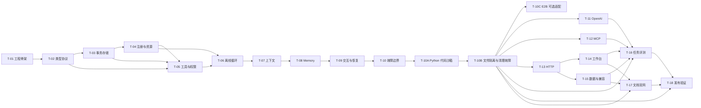

# 分期实施任务与依赖

任务状态统一以 [progress](progress.md) 为准；本页维护前置依赖与验收条件。更新：2026-10-14。

范围唯一维护在 [能力表](capability-matrix.md)，实现选择见 [工程方案](engineering.md)，验证方法见 [质量计划](quality-plan.md)，发布及准备材料见 [维护发布策略](release-policy.md)。T-01 完成证据见 [工程验证](../validation/t01-engineering.md)，T-02 证据见 [类型协议验证](../validation/t02-contracts.md)，T-03 证据见 [存储验证](../validation/t03-storage.md)，T-04 证据见 [注册与资源验证](../validation/t04-runtime.md)，T-05 证据见 [Python 工具验证](../validation/t05-tools.md)，T-06 证据见 [只读闭环验证](../validation/t06-agent-loop.md)，T-07 证据见 [上下文验证](../validation/t07-context.md)，T-08 证据见 [Memory 验证](../validation/t08-memory.md)，T-09 审批/输入子范围证据见 [交互验证](../validation/t09-interactions.md)，该卡完整核查/恢复证据见 [本轮记录](../validation/t09-reconciliation-recovery.md)；T-10 故障矩阵证据见 [专项记录](../validation/t10-faults-cancellation.md)；首期计划共 21 张任务卡（含独立可选 T-10C），任务数量不代表已完成能力；Docker 必交路径不以 T-10C 完成为前置。

## 1. 实施顺序

| 里程碑 | 任务 | 可以评审的结果 | 对外状态 |
| --- | --- | --- | --- |
| M1 离线基础内核 | T-01 至 T-06 | 无 Key 的类型、事务、生命周期、工具权限、Agent 循环 | 开发快照，不冒充完整 v0.1 |
| M2 上下文与记忆 | T-07、T-08 | 可解释输入；跨进程记忆和隔离 | 仍为开发快照 |
| M3 交互、恢复与代码及文件执行 | T-09、T-10、T-10A、T-10B；T-10C 独立可选 | 审批/核查、受控文件 → Docker 执行 → 持久产物及故障边界；E2B 单独验收 | 可选择功能 alpha；未完成能力明确排除，不声称已支持 E2B |
| M4 模型、集成与使用入口 | T-11 至 T-14 | 真实适配路径、MCP、HTTP 和工作台 | 完整路径 alpha 候选 |
| M5 发布准备 | T-15 至 T-18 | 数据维护、评测、文档官网和安装发布验证 | beta/rc，满足门槛才 v0.1.0 |

这些是依赖节点，不是固定周数或对每个节点都发布包的要求。先用替身完成内核，再接真实模型是本轮对 P1 候选顺序的调整，避免模型波动阻塞状态语义验证。

图是阅读辅助；下表前置依赖是执行依据，不因工具允许并发就同时修改尚未稳定的公共协议。保留 T-01 至 T-18 历史编号，T-10A/T-10B 为首版必交；2026-10-14 按 ADR-0016 新增可选 T-10C。必交顺序 T-10 → T-10A → T-10B → 后续集成/评测/发布；T-10C 依赖 T-10B，独立于 T-11 等任务，不向 T-18 添加必交边。若纳入公开构件，其专项验收仍是该 extra 的发布条件。当前状态与资源选择见 progress。

## 2. 任务卡

| ID / 任务 | 前置与输入 | 具体交付 | 完成条件 / 关联 |
| --- | --- | --- | --- |
| T-01 工程骨架 | P4 就绪记录；工程/许可方案 | pyproject、uv.lock、src 布局、py.typed、开发组、CI、LICENSE/必要声明、最小包构建 | 干净环境锁定安装、wheel/sdist 构建与导入通过；导入不写文件/联网；不使用 Key；C-19 |
| T-02 公共类型与适配协议 | T-01；API 字段、工程 schema 子集 | Agent 定义、结果/事件/交互/错误、Limits、ModelCapabilities、工具规范化、协议测试夹具；生成 schema | 判别 union/JSON 往返、不可表示类型/额外字段/非法数值拒绝；注入字段不入模型 schema；C-01/02/04/12，B-15 |
| T-03 存储与原子边界 | T-02；记录归属与事务契约 | 内存/SQLite 存储、排他锁、会话唯一约束、版本 CAS、去重、迁移元数据、事务取消处理 | 真实文件与双进程锁测试；事务全成或全败；身份查询隔离；C-11，B-02/03/09/10 |
| T-04 注册与资源所有权 | T-03；Agent revision 和生命周期 | 注册/指纹检查、依赖装配、任务所有权、自有/借用关闭、槽位预留与基础取消控制 | 重复注册/缺 revision 失败；启动失败清理；Runtime 不丢任务；借用资源保留；C-12，X-02，B-06/07/12 |
| T-05 Python 工具与权限 | T-02、T-03、T-04；工具/身份规则、事务与任务所有权 | @tool、参数/返回校验、ToolContext、PermissionPolicy、Authorizer、受控线程执行、操作记录接口 | read/unknown/deny/ask/allow 顺序正确；未授权计数 0；上下文注入不可伪造；C-02/08，S-01-B、S-03-A/C，B-01/04/10 |
| T-06 离线运行闭环 | T-04、T-05；ScriptedModel | start/run/wait/stream/events/inspect、临时与同步入口、只读路径 cancel、正文授权投影、历史提交、限额、检索离线 example | 脚本替身跑通只读工具→模型→类型结果；临时 ASK 明确失败；断开等待不取消；流与结果一致；C-01/02/04/10/12，S-01-A，B-01/02/06/10/11/13/15 |
| T-07 上下文与检查清单 | T-06；ContextPolicy 与默认预算 | 完整轮次组、输入/清单原子保存、来源/排除清单、确定性裁剪和结果预览、粗估/报告用量、get_context 与分页索引 | 保护内容超限前置失败；重试输入不变；token/协议项不静默漏算；C-05/07，S-01-C，B-08/15 |
| T-08 内置 Memory | T-07；事务与检索规则 | remember/recall/forget、版本墓碑、作用域查询、required/best_effort、最近/子串检索、跨进程 example | 分进程读写、并发 CAS、删除与快照边界；写入成功有事务证据；C-06/07，S-02-A/B/C/D，B-08/09/10 |
| T-09 HITL 与显式恢复 | T-08；三种交互 schema | HumanInput、审批、原子响应与状态推进、resume/recover/cancel、verify、未知写入、审批 example；规范参数/定义指纹与原执行归属绑定适用于后续代码工具，本卡不预建沙箱 API | S-03-A/B/C/D/E 全部离线路径通过；重复响应不重派发、不返回旧审批；取消未知操作仍待核查；C-08/09/11/12，B-01/04/05/07 |
| T-10 故障与取消验证 | T-09；独立事项服务、进程屏障 | 真实崩溃/提交失败/响应丢失/完成取消竞争回归；修复发现的内核问题 | 无额外写入、无虚假成功；ShutdownIncomplete 留锁；重启不重置预算；C-11/12/15，S-03-B/D，X-02，B-03/04/05/06/07/12 |
| T-10A Python 与文件沙箱闭环 | T-10 完整验收；ADR-0016/API/运行第 13 节；可用本地 Linux Docker、固定标准库及分析镜像（执行者准备） | PythonSandbox/DockerSandbox/SandboxLimits/SandboxResult、ArtifactInput/Ref/Limits/LocalArtifacts 真实实现；start/run/stream 输入授予与去重、授权读取、容量预留/暂存/ready 元数据；预检/配置指纹、code/inputs/outputs schema、审批/稳定执行键；有界文本/文件、单次环境与真实离线 example | CSV 输入 → 实际 Python 统计 → summary.csv/chart.png → 原工具结果 → 最终输出；销毁后按 hash 验证下载；同进程两次无共享状态，仅显式引用复用；审批前创建 0、原操作不重派发，输入/输出/hash 与授权绑定；非法/缺失/超限文件无悬空引用，原 code-only 调用/旧记录兼容；静态/类型/schema/安装及本地实际闭环证据齐全；C-02/08/11/12/17，S-01-E/S-02-E/S-03-F，B-03/04/10/16/18 |
| T-10B 沙箱文件隔离、故障与恢复 | T-10A 完整闭环；真实 Docker/合成哨兵/受控 RPC 与文件存储故障/进程屏障；质量专项 | 实际输入只读/路径链接/跨归属边界、CPU/内存/PID/工作盘/文本与产物限额；取消/进程树终止、丢应答、输入/导出暂存/ready/销毁各边界 SDK 硬终止与提交故障；原执行/产物恢复；Linux Docker CI/安装 | B-16/17/18 全部适用真实测试通过；无泄露/未授权字节、重复代码或无依据 ready；停止/销毁不明保留租约/名额，导出丢失不重算；最终本次资源/暂存按台账收尾；真实专项 CI 与干净安装，不以无 daemon skip 或 mock 关闭；C-11/12/15/17，X-03 SDK/stream（HTTP/UI 后置），B-05/07/10/12/16/17/18 |
| T-10C E2B 可选实验性适配 | T-10B；ADR-0016/后端契约；远端验收前需账号、模板/构建、凭据引用、合成上传许可和独立预算 | e2b extra 与真实 E2BSandbox、锁定 SDK/许可/模板及能力 profile；同一 PythonSandbox/文件/产物协议；单次资源/禁外连/非公开、预算预检/账本、原键查询/销毁与故障；文档/安装隔离 | 离线契约及真实远端执行/CSV/PNG/网络/权限/资源保证、创建丢应答/取消/SDK 崩溃/过期/查询清理失败全部通过，原键不二次创建/执行，资源无残留且费用可核对；缺资源留子范围并记录恢复，不能关闭或发布“支持”；Docker 版本可不含此 extra；C-17、B-16（通用边界及云 profile）/17/18，S-01-E/S-02-E/S-03-F、X-03 SDK/stream |
| T-11 OpenAI Responses 适配 | T-10B；官方协议、ModelAdapter 测试集 | 可选 extra、包括 sandbox.run_python 的工具名/schema 映射、流式完整提交、协议项往返、异常/用量、关闭控制 | 本地 HTTP 协议夹具通过，无双重重试；不支持能力启动前失败；真实 smoke 在环境具备后执行并记入 T-16；C-01/04，B-15 |
| T-12 MCP stdio 适配 | T-10B；官方 SDK、MCPFixture | 发现分页/命名/schema 固定、受控调用与断连、进程清理、能力拒绝 | 本地真实 MCP server 成功/错误/卡住路径通过；元数据不绕过审批；C-03/02/12，X-02，B-12 |
| T-13 HTTP 与身份边界 | T-10B；API 映射、相同 Runtime 配置 | DrovApp/lifespan/身份/运行/交互/inspection/SSE；有界文件上传暂存/同 scope 消费、元数据与附件下载、输入引用映射/去重 | 三场景和 X-03 的 SDK/stream/HTTP 对照；代码/文件正文动态授权与归属隔离，猜 ID/撤权/超大上传/未 ready/已清理/重复接收拒绝或复用原事实；HTTP 不收镜像/挂载/凭据/后端配置；SSE 背压/断连/关闭通过；C-13/10/12/17，X-01/03，B-02/06/10/11/12/18 |
| T-14 本地工作台 | T-13；品牌素材、HTTP schema | 页面/会话/上下文/交互/取消重连/wheel 资产；代码/输入清单与有界文本、退出/清理状态、产物列表/安全 PNG 预览/授权附件下载 | 三场景、CSV/图表、拒绝/失败/重连可操作；权限不足不显示字节/文件名，HTML/SVG 不自动内联执行；查看/下载不重执行，无独立循环；C-14/07/09/10/17，X-03、B-10/18 |
| T-15 数据维护与兼容 | T-13；保留/清理/迁移与 Artifact 引用规则 | 离线维护/预览、SQLite+blob 一致备份与恢复/barrier、实际记录迁移/版本拒绝、共享引用/暂存回收、正文导出权限 | 无默认自动清理；未结束/未知执行与暂存租约保护；旧库/事件/派发记录及 ready 文件完整性/墓碑/跨 Session 共享引用/中断备份删除测试；旧备份不能重派发或给悬空引用，未清理沙箱不删除台账；C-10/11/19/17，S-02-D，B-02/07/10/11/18 |
| T-16 场景与真实模型评测 | T-10B、T-11、T-12、T-14、T-15；质量计划 | 汇总三个参考应用及文件/代码执行变体、27 项固定任务 manifest、离线全路径、7 项 smoke 与正式 81 试验报告、体验记录；沙箱真实代码必须由被评测模型生成并实际运行、导出/读取文件；E2B 远端契约与费用另报，不混入必交 Docker 模型分数 | 规则与发布门槛通过；未提供 Key/预算时真实项标待验证，不能宣称正式发布完成；C-15/17，所有 S/X、首期 B |
| T-17 文档、社区与官网 | T-10B、T-14、T-15；已实现能力与品牌、发布策略 | 快速入门/API/部署/限制/排错、Docker/标准库及数据镜像、文件/产物授权/容量/备份与威胁边界、可选 E2B 准备/费用/实际支持表、README、CONTRIBUTING/SECURITY、issue/PR 模板、MkDocs 首页和版本文档、Pages 构建产物 | 干净环境照文档运行离线案例；链接有效、许可归属清楚；官网没有虚构状态；C-19；公开托管条件按发布策略处理 |
| T-18 打包与发布验收 | T-10B、T-16、T-17；全部首期门槛与发布材料 | wheel/sdist 检验、extras/平台矩阵、变更记录、RC 验收报告、发布/回滚说明；具备授权与权限后发布包/站点 | SDK-only 无 Docker 仍可导入/运行；Docker 专项干净安装/真实执行、B-16/17/18、真实 CSV/PNG/持久下载与隔离故障全部有证据，缺 daemon/镜像只完成子范围，不能关闭整卡；安装/示例/故障矩阵及模型门槛有证据；Tag 与构件对应；E2B 未完成可排除该 extra，纳入则需 T-10C 远端/安装/许可证据；未实际上传不写“已发布”；C-19/15/17 |

T-05 定义/权限可仅基于类型，完整派发验收实际复用 T-03 事务与 T-04 所有权，前置已相应细化；已用真实 Python 函数/线程和计数夹具验证只读派发，write/unknown 明确拒绝，T-05 当时 ASK 不生成假交互；T-09 显式 Runtime 的审批/输入路径现已落地。T-06 已交付只读闭环，外部 write/unknown 已沿 T-09 的审批/unknown/核查接入，T-10 验收硬崩溃矩阵；不能借开发快照绕过审批。T-08 内置 Memory 使用专用事务路径。T-06/T-08/T-09 分别建立离线示例，T-13 复用其夹具，T-16 汇总评测；因此 T-17 可以验证已有离线示例，不依赖付费评测完成。T-17 先完成本地站点，公网绑定和包上传在有具体构件后办理。

任务卡是验收单元，不要求一次提交塞入整个模块。较大的任务按以下顺序分批评审，并在 progress 中记录已完成的子范围；只有整张卡验收通过才关闭：T-10A 的后端/镜像与 Artifact 配置 → 输入接收/授权/去重 → 审批与真实执行 → 有界导出/ready 发布/下载及兼容；T-10B 的文件隔离/限额 → 取消与清理 → 输入/暂存/发布/销毁故障与重启 → 专项 CI/安装；T-10C 的真实离线 adapter/能力拒绝 → 授权资源准备 → 远端执行/文件/费用 → 远端故障/清理/安装；T-03 的记录/作用域 → 事务/CAS/去重 → 锁/提交故障；T-06 的只读循环 → 事件/授权/历史 → 流/取消；T-09 的审批响应 → HumanInput → 未知效果/verify/恢复；T-15 的维护预览/墓碑 → 备份 barrier → 兼容与导出。未完成子范围不能记成整项能力完成。

### 新增沙箱任务的子范围与退出规则

- T-10A 预检只核对宿主配置/镜像/文件存储能力，不运行模型代码；执行前先持久化执行键/代码与文件清单 hash/配置/预算，再接触后端。分析镜像由执行者准备并记录实际版本/digest，不要求用户手工求 hash。结果与清理事实必须来自真实容器。具体数值只维护在工程方案，语义只维护在运行契约第 13 节。
- T-10B 的故障夹具只能操作测试创建并标记归属的容器；模拟连接丢失采用受控代理/客户端故障，不关闭用户共享 daemon。测试先限定资源，再运行超限/子进程样本，父进程有独立收尾期限和清理台账。
- 无模型 Key 可完整完成两卡的离线实现；无可用容器环境时可以验收描述/校验/协议子范围，必须记录真实执行/隔离/故障缺项和恢复步骤，不关闭 T-10A/T-10B，不绕过 T-18 的正式发布门槛。
- T-09/T-10 继续完成原任务，保持完整审批/取消/未知结果/恢复契约；沙箱专用定义、执行句柄及记录演进在 T-10A 实施，不为本轮范围变化预建代码空壳。

## 3. 能力覆盖索引

| 能力 | 任务 | 首期验收证据 |
| --- | --- | --- |
| C-01 | T-02、T-06、T-11、T-16 | 模型协议、离线闭环、真实任务报告 |
| C-02 | T-02、T-05、T-06、T-10A、T-12 | 参数/权限/顺序派发、MCP 同契约 |
| C-03 | T-12 | 本地 MCP 真连接及生命周期 |
| C-04 | T-02、T-06、T-11、T-13 | 类型结果、完整流、版本事件 |
| C-05 | T-03、T-07 | 会话隔离、完整消息组、预算 |
| C-06 | T-08、T-16 | Memory 事务/进程与任务质量 |
| C-07 | T-07、T-08、T-14 | manifest 内容、来源和 UI 排错 |
| C-08 | T-05、T-09、T-10A、T-13 | 授权边界和控制接口 |
| C-09 | T-09、T-14 | 审批/输入/核查与 UI |
| C-10 | T-06、T-13、T-14、T-15 | 本地事件、耗时/已知用量、脱敏导出 |
| C-11 | T-03、T-09、T-10、T-10A、T-10B、可选 T-10C、T-15 | 原子边界、文件/执行恢复、备份/迁移 |
| C-12 | T-04、T-06、T-10、T-10A、T-10B、可选 T-10C、T-12、T-13 | 所有权、订阅分离、关闭 |
| C-13 | T-13 | 会话/运行/交互/事件服务、身份适配 |
| C-14 | T-14 | 必需工作台流程；实验性 UI 稳定承诺 |
| C-15 | T-10、T-10B、可选 T-10C、T-16、T-18 | 离线、故障、模型、干净安装报告；E2B 远端/费用独立报告 |
| C-16 | 首期不实施 | 架构保留候选；后续任务需 B-14，未跳过后假称通过 |
| C-17 | T-05 检索；T-10A/T-10B Docker 与文件/产物；T-10C 独立可选 E2B；T-13 至 T-18 相应集成/维护/发布 | Docker 受控输入/持久产物首版必交；E2B 未验收不声称支持、不阻塞 Docker；Skill/持久工作区等后续 |
| C-18 | 首期不实施 | 调度/渠道后续独立提案，无空插件壳占位 |
| C-19 | T-01、T-15、T-17、T-18 | 安装、文档、迁移、许可、网站/发布状态 |

## 4. T-01 工程骨架交付

P4 宣告就绪后，第一轮完成 T-01，按以下范围为 T-02 保留清晰接点：

1. 按工程方案建立 Python 包、声明运行版本和可选依赖，解析开发锁；不创建虚假的 Agent.run 实现。
2. 配置格式、类型和测试入口，以及无凭据 CI；加入项目许可和来源记录入口。
3. 构建 wheel/sdist，在新的临时环境中安装，验证包版本/类型标记、SDK-only 导入无可选依赖和导入无副作用。
4. 检查品牌素材保持原样；写明实际环境、通过检查和下一轮 T-02。

不为“有测试”添加只断言 True 的样板；T-01 的检查针对包结构与依赖边界，业务测试从 T-02 开始。实际执行记录和未验证平台见工程验证；没有提前实现 Agent/Runtime。

具体交接见 [实施基线](implementation-baseline.md)。骨架采用本地开发版本 0.1.0a0；这不是 PyPI 发布或名称占用声明。初期只提供版本和类型标记，不预先暴露返回假结果的 Agent/Runtime，也不声明尚未实现的 CLI 入口。安装与构建验证记录本机实际环境；已编写但未在远程执行的 CI 矩阵只能标为已配置。

## 5. 后续版本如何选内容

首版之后按用户问题、缺陷、测量结果排序，每次 release 选择一个可以说明的结果和回归范围。优先修复错误与难用路径，不要求每次都新增大模块。

| 版本方向（非日期承诺） | 候选结果 | 进入条件 |
| --- | --- | --- |
| 0.1.x | 修复缺陷、改进错误提示、补充案例/兼容性 | 有复现或使用记录；不偷偷改变核心状态语义 |
| 0.2 | 一级顺序委派、远程 MCP、OTel 三者按证据选择一到两个 | v0.1 三场景回归稳定；委派须完整实现 B-14；远程 MCP 须明确认证/断连边界 |
| 后续次版本 | Skill、外部 Memory、自动记忆、调度/渠道、持久 Notebook/多语言/其他云沙箱与更强隔离后端（首期系列可选 E2B 见 T-10C） | 分别有独立场景、权限/生命周期/一致性方案和测试；不要打包成一次无边界重构 |
| 1.0 候选 | 已使用验证的稳定公共协议、迁移和维护承诺 | 多个版本的兼容实践及真实外部使用证据；不以功能数量达标 |

版本具体范围仍须回写能力表；这张表只规定选择逻辑，不另行承诺时间。收到新想法先记问题、目标 G、影响的 C、证据、维护成本和最小交付，再决定进入哪个版本。每轮结束保持 progress 与实际代码一致。
