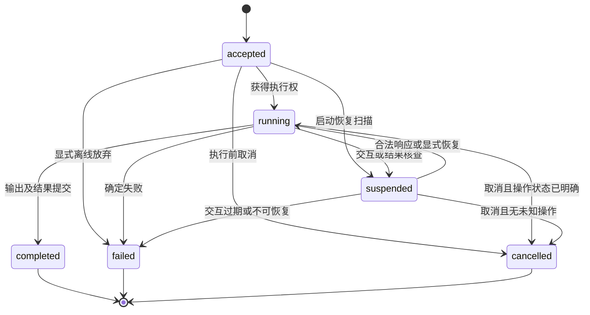

# 运行行为契约 v3

状态：P4 实施基线；T-03 至 T-08 已本地验证事务存储、资源/任务、只读 Agent 闭环、正文授权、SDK 订阅、上下文选择/清单及内置 Memory；T-09 审批/输入子范围已实现；T-09 已实现外部未知效果与显式恢复；T-10A 文件/代码沙箱闭环已实现；HTTP 和真实模型尚未实现。T-06/07 细化见 [ADR-0010](../decisions/0010-read-only-agent-loop.md) / [ADR-0011](../decisions/0011-context-assembly.md)。更新：2026-10-14。

本文是 Drov 自己拟采用的行为规则，不是竞品能力声明或已通过的测试报告。关联 C-01 至 C-15、C-17 和 Q-API-01 至 Q-API-08；模块归属见 [架构](architecture.md)，用户调用见 [API](api-draft.md)，默认数值见 [工程方案](engineering.md)。子运行内容为后续 C-16 契约，v0.1 不提供该能力。

## 1. 入口、所有权和便利调用

所有入口使用同一执行内核。`Runtime.start` 接收并保存运行后返回 RunRef；`run` 是 start + wait，`stream` 是 start + subscribe；HTTP 使用 start 后以独立请求取得事件或结果。

Runtime 拥有执行任务并保留强引用；等待层须隔离调用者取消向执行任务的直接传播。调用者取消等待、关闭流订阅或 HTTP 断连，均只解除订阅/等待，不等于取消执行；必须显式 `cancel`。Runtime 退出时执行第 9 节的关闭协议，不能产生无人管理的执行任务。Python 语义依据为 [E-07](evidence.md)，T-04 已验证私有内核任务/等待/真实底层调用引用；T-06 已验证 SDK wait/stream 退出与显式 cancel；HTTP 断连由 T-13 验证。

`Agent.run` 创建临时内存运行环境，默认无会话延续、长期记忆或可恢复交互。配置持久化 Memory 时提前抛出 ConfigurationError，要求显式 Runtime。T-10A 的 PythonSandbox 也要求显式 Runtime 与 SQLiteStorage；其资源/进程恢复不得隐式退回临时内存运行。已接通该显式配置，详见第 13 节。动态遇到审批/补充输入时，返回 `failed / interaction_unavailable`，附非可恢复的交互说明；对应待授权工具不执行，不生成暗示可恢复的 request_id。此前已发生的合法操作仍保留在结果说明中。

临时入口的错误不会自动降级成批准。SDK 与 HTTP 比较时使用相同 Runtime 配置；不能把临时配置与持久化配置的差异算成行为不一致。

同步仅提供 `Agent.run_sync`，使用同一临时执行路径。当前线程已有事件循环时抛出明确的入口使用错误，提示改用 await；不嵌套事件循环。首期不提供长期 Runtime 的同步镜像 API。

## 2. 运行状态

| 状态 | 含义 | 是否结束 |
| --- | --- | --- |
| accepted | 已提交接收记录，尚未进入执行步骤；不代表已有独立队列服务 | 否 |
| running | 内核持有执行权；可处于等待模型/工具的内部阶段，未来组合可含子运行 | 否 |
| suspended | 不再推进 Agent，等待审批、输入、核查或显式恢复；未能停止的旧调用仍可占用资源 | 否 |
| completed | 输出校验通过，输出与最终事件已提交 | 是 |
| failed | 有明确原因无法继续，失败记录已提交 | 是 |
| cancelled | 不再继续执行；已完成与未执行操作均有记录 | 是 |

`RunOutcome` 只返回 completed、suspended、failed、cancelled 的快照，包含 state_version；运行期间查询返回 RunSnapshot。只有 completed 带成功 output。suspended 在后续恢复后可能变化，旧快照不是实时对象。

同一会话至多一个未结束 Run；并发新请求返回 SessionBusy。Session 绑定 agent_name，换 Agent 使用新 Session；同名新 revision 只在没有活动 Run 且会话 schema 兼容时可显式选择。调用者可用 request_key 去重创建：键作用域为 `(tenant_id, user_id, session_id, request_key)`，同键同规范请求（输入、Agent name/revision、显式限额，以及 T-10A 新增的有序不可变文件清单）返回原 RunRef，同键不同请求返回冲突。先验证当前授权及去重，再检查 SessionBusy 和新运行容量；运行中或结束后的同键重试均不会创建新运行。原 RunRef 的 state_version 保留接收时版本，最新状态通过 inspect 获取。正文清理后仍保留去重墓碑，同旧键返回 Gone 而不是新建，见第 11 节。

新 start 在提交 accepted 前预留 Runtime 活动槽位，容量不足不创建 Run；accepted 仅是已接收至实际调度之间的短暂状态，不形成无界或后台持久队列。任务调度失败须落入 recovery 暂停；若连存储也失败，停止推进并按第 8 节在重启扫描时处理。响应和恢复的容量规则同样不允许先消费请求再等待一个没有所有者的队列。

终态不得通过 resume 复活。重新尝试终态任务需要新 Run，并明确输入和外部副作用处理，不能把此前写入视作不存在。

## 3. 步骤、事件与检查点

恢复单元是已提交的运行步骤，不是整个 Python 函数、对话或模型节点重跑。

每次关键状态变更，在一个存储事务内保存：新状态与版本、继续执行所需检查点、对应持久化事件。条件更新校验旧 state_version，避免重复响应或并发控制操作推进两次。事务提交前不对外宣布 durable 成功。

关键边界包括：接收输入；上下文准备完成；完整模型响应与工具计划落盘；工具调用意图；派发标记；工具结果；交互请求/响应；最终输出。外部模型或工具调用不在本地事务中执行。

| 数据流 | 保证与用途 |
| --- | --- |
| 持久化事件 | 每 Run 的 seq 递增，含 schema_version、类型及记录引用；供恢复解释、检查和 SSE 重连 |
| 临时增量 | 模型 token 等实时展示数据，可能丢失；不分配伪造的持久化游标，不参与恢复 |
| Trace 导出 | 从运行事件形成观测信息；导出失败不推翻已提交运行结果 |

HTTP SSE 使用 `run_id:seq` 作为持久化事件游标，可重送，由客户端去重。临时增量不设置该游标；重连不保证逐 token 补发，但能取得已提交的完整消息。持久化历史超出保留范围时明确返回 cursor_expired，并引导获取快照。

慢消费者使用有界缓冲：临时增量可被丢弃并标记 gap；持久化事件可由存储补读。不得让慢 UI 造成无界内存占用或阻塞模型执行。

订阅补读历史后，只有追到当前暂停/终态快照对应的已提交 seq/state_version 才结束；历史中的旧 suspended 事件不能中断已经恢复的当前 running 阶段。读历史与接入实时通知之间必须按 seq 补读消除漏读窗口。当前已暂停且游标已追平时可直接结束；响应后重新订阅后续 seq。前端以 state_version/seq 更新，不把两次快照合并成新事实。

存储失败时停止推进，不执行后续外部动作。如果结果无法提交，调用方收到 PersistenceUnavailable，不能伪造已持久化的 failed/ completed；下次恢复依据最后一个成功提交的边界核查。

## 4. 工具执行、重试与未知结果

T-05 已实现 @tool/PythonTool 和私有只读派发接点：同步工具先有界排队再派发，异步工具保留真实 Task；OperationJournal 同事务保存操作/Run 摘要、检查点、事件和 tool_dispatch_count 预算预留。每个重试只有显式 TransientToolError 才允许，超时/非法输出不重试。已有 operation_id 返回旧事实，不自动批准或重做；T-06 已接入完整计划提交与只读 Run 收尾；T-09 已接入审批/输入子范围；外部未知写入与显式恢复由 T-09 本轮交付，逐故障边界硬崩溃另在 T-10 验收。T-09 已接入外部 write/unknown 单次派发与核查；T-08 内置 Memory 使用第 7.3 节的专用事务路径。

工具先完成 schema 校验和权限判断，再执行。参数被校验后规范化为确定性的 JSON 值：键排序、禁止 NaN/Infinity、保留值类型；首期不隐式转换 datetime 等非 JSON 类型，应用须显式转为受支持的表示。调用摘要包含工具名/版本、参数、归属和目标操作标识；不能仅 hash 提示词。

每个调用生成稳定 operation_id。保存完整调用计划后按顺序执行，执行阶段为：prepared → dispatched → succeeded / failed_known / unknown。prepared 之前或尚未 dispatched 的调用可证明没有由本次派发执行；dispatched 在真正调用外部服务前提交，二者之间崩溃会保守地视为可能执行。

| 情况 | 行为 |
| --- | --- |
| 参数或授权不通过 | 不调用工具，记录拒绝/校验错误；预算允许时模型可选择其他合法行动 |
| 只读工具暂时失败 | 在明确的重试次数与时间预算内重试，记录每次尝试 |
| 写入工具明确未执行 | 按工具契约决定是否重试；一次新调用不能继承不匹配的审批 |
| 外部结果已提交 | 恢复时使用记录，不再执行该调用 |
| 已派发写入但结果未知 | suspended / reconciliation；禁止盲重试，也不能把工具错误文本当成“未执行”证据 |
| 工具声明可幂等重试 | 必须有经验证的外部幂等键契约；恢复使用同一 operation_id、参数及有效授权 |

工具的 `effect` 元数据用于调度和策略，不是安全证明。缺省为 unknown，按可能写入处理。幂等保证不能只靠一个布尔开关；适配器需要说明稳定请求键、结果查询及错误分类。首期通用工具默认不保证写入重试安全。

应用可通过 verify 调用已注册的只读 verifier，或由获授权的人直接提交核查证据；不自动后台轮询。verify 针对当前 reconciliation request_id，以原运行归属和 operation_id 查询外部证据，返回 ReconciliationDecision，不消费请求、不继续 Agent；结果须再经 respond/resume 的版本和当前权限校验。未注册 verifier 返回 ConfigurationError。超时/查询失败返回 unresolved 与安全错误说明，不猜测未执行；查询尝试保留审计。

核查响应提供 applied / not_applied / unresolved 及依据；无依据确认不得自动复用成功结果。正常继续 Agent 时 applied 必须带可校验的工具结果；已经请求取消或耗尽运行预算时，充分证据确认效果即可收尾，不要求为不会继续的模型补造返回值。not_applied 在原调用已停止且证据充分后，才允许重新走授权/审批派发；unresolved 保持暂停。核查使用相同 operation_id 查询证据，不自动重放原写入。

外部写入已完成但返回值不符合 schema、不可序列化或超过大小上限时，记录 effect 已执行/可能执行与 output_unavailable，不把输出处理错误当成未执行；能够明确已执行但无可用结果时失败并保留操作摘要，无法判断效果时暂停核查。没有可验证结果不能编造成功工具结果。

取消标志存在时，核查只用于确认已发生的动作，不能再启动原写入。确认结果后终结为 cancelled；未知结果尚未处理时保持 suspended，并保留 cancel_requested。

## 5. 审批与其他人工交互

HITL 请求有三种可响应类型：approval、input、reconciliation。启动恢复产生 reason=recovery 的暂停，使用 recover 入口，不伪装成人工审批请求。单 Run 首期最多一个活动交互请求；pending 为单个请求或 None，与 API v3 及 T-02 类型一致；集合形状需后续公共契约变更，不能假装首期支持。

补充输入由注册的内置 HumanInput 工具描述触发。模型只提出 prompt，响应 schema 来自应用注册的 input_type。它无外部写入，以 read 注册并遵守完整工具权限顺序，默认直接产生 input 请求，应用配置的 deny/ask 仍生效。合法 InputResponse 持久化后成为原工具调用的结果，再继续模型循环；不重跑工具函数、也不恢复任意 Python 栈。首期普通 Python 工具返回文本/对象不会自动触发控制流。临时入口仍按 interaction_unavailable 处理。

审批绑定固定 operation_id、规范参数摘要、工具版本、原执行归属和有效期。响应只表达批准/拒绝；首期不支持在原审批内顺便修改参数。需要修改时生成新候选调用和新请求，旧批准不能沿用。有效且匹配的已保存批准可以满足该操作的 required approval，不再次询问同一请求；派发前仍需检查当前业务权限。批准在派发前已经过期则以 interaction_expired 结束，不使用过期批准。

响应处理按顺序执行：校验当前调用者及响应权限 → 查已保存回执 → 对新响应校验类型、有效期、摘要、状态版本及继续所需原 revision/依赖 → 为需要继续的运行预留活动槽位 → 原子提交响应、请求消费、检查点、事件和后续状态。正常继续时该事务直接改为 running，不能留下“响应已接受但仍展示原审批”的窗口。unresolved 则在同一事务换新请求并保持 suspended；无需继续的取消核查可直接提交终态。派发前仍重新核验原执行者当前权限。

活动容量不足返回容量错误，原请求保持未消费；缺 revision/依赖也不消费。只记录 unresolved 或结束取消等无需新 Agent 工作的控制操作不要求活动槽位。消费后的任务调度失败必须转成 recovery 暂停；崩溃由启动扫描处理。取消与响应共享版本条件更新，安全终结时使原待处理请求失效；竞争失败重新读取，不能执行过时请求。

同 request_id 重复提交相同规范响应返回已有响应回执，不再次执行；在当前响应者仍有权限的前提下，即使原请求后来过期或 Run 已终结也适用。通过 inspect/wait 获取最新状态，回执自身的 state_version 保留消费时的版本。内容冲突返回 InteractionConflict。响应校验失败不消费请求。批准人与原运行用户可不同，但必须经应用授权；工具继续使用原运行归属，不能自动获得批准人的凭据或更高权限。

核查提交 unresolved 后保留旧响应回执，并在同一事务中为原 operation 创建新的 reconciliation request_id，继续 suspended；这样之后的新证据能合法提交，不与旧响应去重冲突。已有同响应重试只返回原回执，不再生成更多请求。

拒绝审批作为明确的 denied 工具结果进入上下文，模型可在剩余预算内解释或选择其他行动。工具授权规则保持有效，不能通过换名称绕过。补充输入校验失败允许用户修正；审批/补充输入有效期到达后以 interaction_expired 结束原运行。核查请求的 expires_at 仅为提醒期限，到期仍保留 suspended 和未知操作，继续接受合法核查证据；不能用过期自动断言外部未执行。

有效期在控制操作、读取状态、恢复扫描和派发前检查；首期不声称有独立分布式定时器能在过期瞬间主动发通知。

T-09 已实现 approval/input 的请求、回执及 respond/resume；原计划继续、当前权限/到期复核和两种存储证据见 [ADR-0014](../decisions/0014-durable-approval-input.md) / [验证](../validation/t09-interactions.md)。HumanInput 合法响应在消费事务内复核原用户业务权限/deny；非法输入或撤权不消费。本轮已交付 reconciliation、verify、recover 和启动扫描，实际范围见 [ADR-0015](../decisions/0015-external-effects-recovery.md) / [验证](../validation/t09-reconciliation-recovery.md)。查询非协作任务保留所有权，终态后完成的查询仅追加独立审计回执，不改终态版本。新增内部数据归属见架构，记录布局见工程方案。

## 6. 身份、权限与依赖

HTTP 的认证适配器产生可信 RunContext；本地 SDK 由宿主程序提供。HTTP 请求体中的 user_id/tenant_id 不得覆盖认证结果。本地模式、可信来源与非本地绑定要求在 [工程方案](engineering.md) 固定，不能默认信任浏览器请求头。

Run/Session 查询必须检查 tenant_id + owner user_id；批准和管理员查看使用单独授权能力，不能只知道 run_id 就访问。未经授权查询对外不区分不存在和无权访问。

读元数据与 view_content 分开。inspect/events/get_context 默认 include_content=False；返回有限的状态、ID、事件类型、用量等投影，不带输入、输出、工具参数/结果、交互 prompt、Memory key/content 或供应商正文。RunSnapshot 的 outcome 在此投影中为 None，pending 保留请求标识/类型/期限，content_visible=False 表示正文未提供；状态仍然真实，不能用脱敏字符串冒充类型化 output。

显式 include_content=True 需 read 与 view_content；缺权限直接拒绝。run/wait/resume、stream 及 recover(wait=True) 会返回正文，须在创建或消费控制输入之前预检对应权限；运行中撤权后停止向该调用者提供正文，不回滚已合法接受的执行。stream/events 每次发送正文前重新授权，元数据模式不发送 token.delta。默认 authorizer 给本人读正文及本人控制权限，跨用户审批者的查看和响应权限由应用分别授予。只具响应权限者使用 respond 得到回执；审批权限不会隐式授予结果查看权。raw provider_items 仅用于协议往返，不作为可显示正文。

权限判断固定顺序：作用域/业务授权否决 → 显式 deny → 工具 required approval 或显式 ask → 显式 allow → 应用注册为只读且通过动态检查的调用 → 默认 ask。allow 不能覆盖 deny 或 required approval。输入数据、工具返回和模型消息不能改写这套顺序。T-05 由 Authorizer.execute_tool action 和 ToolResource 承担当前业务否决，队列等待后、派发标记提交后再检查；授权错误/超时不派发，参数快照不允许授权器修改实参。Policy 集合不可变，Runtime 配置引用只读；宿主可让原 authorizer 对象反映当前业务权限。

ToolContext 由内核注入，包含已验证归属、run_id、operation_id 和经应用解析的依赖。模型能填写的 schema 中不存在这些控制字段。工具仍需遵守业务后端自己的权限校验；Drov 的检查不是沙箱或对任意工具代码的可信证明。

恢复前重新解析依赖和权限，未配置的必要依赖返回明确错误。不得从旧快照恢复 token、连接池、Python 闭包或 pickle 对象。

## 7. 上下文和 Memory 时序

### 7.1 模型输入装配

Session 历史是已提交消息事实的投影：接收 RunRecord.input 是用户输入的唯一事实，Checkpoint.session_sequence 同事务保存以保持会话顺序，不依赖相同墙钟时间戳的 UUID 顺序；完整模型计划和实际工具结果随步骤提交，以稳定记录 ID 引用，不能在每次检查点复制后又重复拼接。模型未完成的流不进入历史。只有当前计划各调用都有明确结果，才允许下一次模型请求。

failed/cancelled 结束时，对计划内从未派发的调用记录 not_executed 及原因，保留实际结果和未知效果说明；这些结束记录不是可重试的执行检查点。终态与会话投影游标同事务提交，下一 Run 使用完整的调用/结果组，不拼接半个计划。显式 data_abandoned 也保留 indeterminate 事实，不合成成功或“未执行”结论。历史 schema/协议不兼容时在模型调用前报错，不重写旧事实；裁剪以完整组为单位。

在每次新的模型调用前形成固定 ContextManifest：读取当前已提交会话/运行数据 → 执行记忆检索策略 → 收集候选内容 → 按预算选择/处理 → 保存清单和输入引用 → 调用模型。

同一次模型调用重试使用同一份已保存输入；不重新检索而静默改变问题。进入下一次推理步骤才重新装配。

必须保留的部分包括系统规则、当前工具 schema、当前用户请求和协议要求的完整消息/工具结果关系。完整工具调用与结果成组处理，不能裁掉一半导致协议失配。保留部分已超预算时，模型调用前失败为 context_overflow。

余量先按明确的 Memory 子预算纳入检索记忆，再选择最近的完整历史组；Memory 未启用时不保留空置份额。一个旧 Run 的输入、完整响应、工具结果及对应 provider_items 是一个组；按最近到最旧尝试，装不下的组排除后继续尝试更旧组，最后按原顺序排列。当前 Run 的输入及所有已提交协议链均保护。当前工具结果按结果大小策略保留预览/引用，必须标注来源和处理方式。v0.1 只提供确定性的裁剪与结果截断；模型生成压缩摘要移到后续，届时也必须显式启用并记录调用、错误与消耗。

输入预算从模型能力和应用上限计算并预留输出空间；模型上限未知且未配置应用上限时拒绝猜测。默认数值及粗估算法在 [工程方案](engineering.md)，选择顺序与溢出行为在此固定；估算不能冒充供应商精确 token 计数。

检查视图记录来源 ID/版本、估算或报告的 token 数、选入/排除及原因、截断/压缩操作、记忆检索结果状态。不能承诺展示模型未公开的内部思维。

T-06 已交付完整历史投影及固定模型输入；内部 model_input/model_response payload schema_version=1，完整响应与所有稳定 operation_id 先提交再派发，provider_items 仅内部往返。终态事务将 prepared 操作保存为 not_executed；计划中尚未创建的调用在历史中依据终态投影为 run_ended_before_dispatch。临时增量不入历史。T-07 已接入完整组选取、预览和 ContextManifest。工具预览是带 source_ref/source_version、sha256、original_bytes、truncated 的 drov.tool_preview 文本摘录，绝不把半段 JSON 当原结果；原始工具记录保留。保护输入超预算时，当前结果的共享预览上限依次减半至引用/标记所需最小值；标记或其他保护项仍无法装入就前置失败。历史结果按配置上限预览，整组不合预算就排除。

候选读取、model_input/context（payload schema_version=1）、事件和检查点同事务保存；提交失败无模型调用。context_overflow 仍保存 rejected 的固定输入/清单及 context.prepared（带 error_code），模型步/attempt 计数不增加。重试不改变输入 hash/清单。来源正文只包含选入的处理后消息，排除项仅保留元数据，provider 正文从不展示。estimated_tokens 是全请求粗估，reported_usage 关联已提交完整响应，未知不填 0，且不改写装配快照。get_context 默认元数据、读取后复核权限；context.prepared 保存固定大小摘要；inspect 只索引当前事件页，索引不读取完整输入/清单，reported_usage 保留装配时的未知值，详细 sources/已报告用量由 get_context 读取。T-06 无摘要事件不生成伪索引，状态/事件仍可读。见 [ADR-0011](../decisions/0011-context-assembly.md) / [T-07 验证](../validation/t07-context.md)。

### 7.2 读取策略

- required：等待这次检索完成至其超时预算；失败或超时则在模型调用前 failed / memory_unavailable。成功检索零条是合法 empty 结果。
- best_effort：在配置的等待预算内读取；超时则记录 skipped，取消/清理该读取任务，在当前调用中不使用迟到结果；当前 DTO 用 retrieval_status=timeout 表示 skipped，异常用 failed。下一轮可重新检索。
- 读取取消后最多再等待 100ms 清理；仍未停止时抛出 PersistenceUnavailable，禁止模型调用并保留实际任务/槽位/存储所有权，不伪称已完成清理。首期不保留无界后台检索任务，不向已经发出的模型请求追补内容。Memory 工具主动读取的结果同样记录来源；显式 recall 的工具结果若被预览截断，其记忆来源也标为 preview，仅保留版本元数据。

### 7.3 写入与作用域

首期使用 Runtime 的事务存储提供内置 Memory，默认作用域为 `(tenant_id, user_id, agent_name)`。不同 session 可共享，其他用户和其他 Agent 不自动共享。检索必须在存储查询阶段带作用域，不能先取全量再由模型筛选。首期只提供最近记录、精确键和子串检索，算法与限额在工程方案，不声称是语义检索。

`Memory(retrieval=..., writeback="explicit")` 注册受控的 `memory.remember`、`memory.recall`、`memory.forget` 工具；explicit 指有明确工具操作，不代表每次必须人工批准。应用需要为允许自动保存的记忆工具配置权限；这些工具名保留，不得被同名自定义工具覆盖。

内置记忆写入/删除、工具成功结果与 memory.changed 事件在同一个事务中提交，再向模型返回成功。这是 Runtime 专用事务处理器完成的本地操作，不经过外部工具的 dispatched/unknown 路径；普通 Python 工具不能仅声明元数据就获得这一保证。因此跨进程场景可以根据持久化事件确认已保存，无需任意 sleep 或后台 flush。memory.changed 至少包含 action（remember/forget）、key 和 version。Run completed 只说明任务结束，不说明模型一定调用过保存工具；案例必须检查实际写入证据。

内置工具准备后复核权限，等待事务锁后再次复核并检查取消；最终权限复核在存储事务内，Authorizer 不应重入同一 Storage 的事务（会明确拒绝）。工具规范结果/大小检查在修改前完成。成功或已知冲突等本地尝试与 tool_dispatch_count、独立 attempt_id 同事务记录；没有 tool.dispatched 事件或外部 unknown 状态。参数/权限拒绝计数 0，事务回滚计数 0，不自动重试。超时若已经提交则保留已提交结果，随后取消/失败不撤销记忆。

同一 key 的修改以读取版本进行条件更新；从未存在的 key 新建 expected_version=0，删除保留版本墓碑，精确 key 读取可获得墓碑版本后重建，不能回退版本。墓碑不进入普通检索或自动上下文。其他会话已修改、forget 的键不存在或已是墓碑时返回 memory_conflict，不盲覆盖。重复 operation_id 返回已经提交的结果，不再次写入。重新检索或重新提出修改需要新的明确步骤。

每次写入记录 key、version、来源运行/调用、时间与内容。失败不得返回成功工具结果；即使最终语言回答声称“已记住”，测试也必须据存储事实判错。后续失败或取消不会自动撤销已提交的记忆写入。

首期不做回复后自动提取、整合或后台写回。外部 Memory 后端如果不能参加事务，就必须用独立操作记录和一致性协议设计，不能套用内置保证；P3 已将其定为后续集成。

forget 使对应当前记忆不再参与后续检索，不等于删除既有对话、已提交输入快照、Trace 或备份。检索任务先按期限完成，再在保存输入的事务内逐项复核版本；删除/版本冲突时重新查询当前 scoped 最近记录，旧候选以 memory_deleted/memory_version_changed 排除并记录原版本，不重新启动后台检索。manifest 提交前的复核、重建、选择和输入保存共用同一事务；提交后本次调用及重试使用固定输入。清除旧输入快照需独立数据清理，随后不能再以该快照重试；已发给模型的请求不可撤回。

### 7.4 数据记录

运行正确性所需的消息/参数/检查点与可选的调试导出分开管理。默认外部观测只导出必要元数据，内容记录显式开启；检查点仍可能含恢复所需内容，不能宣传为“完全不保存内容”。

凭据不进入普通消息、操作参数和导出器；内容脱敏、授权、保留与删除规则在 [维护策略](release-policy.md)。删除恢复必需数据后明确将对应运行标记为不可恢复，不静默编造缺失内容。

T-06 的正文查询按 context 的 tenant/user 作用域，包含结果投影和每次事件发送的动态复核；T-09 已接入同 tenant 经应用授权的跨用户查看/响应；服务身份解析尚未交付。SDK 订阅只将临时增量放入有界队列，durable 事件从存储分页补读，至多 50ms 轮询活动执行的提交；追平当前暂停/终态才结束。未知事件不展示任意载荷。显式 Runtime 的 ASK 保存持久审批，HumanInput 保存补充输入；临时入口仍 failed/interaction_unavailable，无实际交互 ID。T-09 外部未知效果与显式恢复已实施；硬崩溃专项仍由 T-10 验收。

## 8. 进程恢复与版本兼容

新 Runtime 获得排他存储所有权后扫描未结束记录，不自动重启所有外部动作。原 suspended 请求保留；accepted/running 变为 suspended / recovery，已派发且结果未知的写入优先变为 reconciliation。

`recover(run_id)` 需要明确调用和当前授权：检查 Agent revision、schema 与依赖 → 读取最后提交步骤 → 使用已提交模型/工具结果 → 对缺失结果按工具执行契约处理。不能重新执行已提交操作，不从任意 Python 调用栈恢复。

若模型响应未完成提交，可以再次请求模型，但会有新 attempt_id、可能额外费用和不同输出；没有保存完整工具计划前不得执行其中任何工具。

处于 approval/input/reconciliation 的运行使用 respond/resume 处理相应请求，recover 不绕过这些等待。结构化恢复错误允许修复环境后再次 recover；不因第一次依赖缺失自动丢弃任务。

## 9. 超时、取消和退出

T-04 已实现资源生命周期、私有任务控制和槽位原语，见 [ADR-0008](../decisions/0008-runtime-ownership.md)。T-06 将公开只读 cancel、模型/工具/活动预算接入事务；完整恢复及未知写入仍由 T-09/T-10 验证。已派发调用必须登记真实 Future，取消后的包装 Task 不能用作实际调用已结束的证据。

每次模型/工具调用、单次推进和整个 Run 的累计执行都有明确预算；人工等待不消耗活动执行时间，但请求有效期与可配置总墙钟期限仍生效。默认数值与崩溃后的保守预算结算见工程方案；重启不重置计数。终态费用只能标识已知消耗，超时/取消可能仍有供应商计费。

取消设置 cancel_requested 并禁止新的模型、Agent 工具或子任务派发。已派发操作协作停止；只读/模型失败可按已知状态结束，写入状态无法确认时必须暂停核查。异步取消信号和线程 Future 取消都不等于远端操作撤回。对终态调用 cancel 幂等返回该状态的回执，不把 completed 改成 cancelled；完成提交与取消请求通过 state_version 竞争，按先提交的有效变化处理。

活动/步骤预算耗尽或 Run 总期限到达时停止新的 Agent 工作；已知边界以 limit_exceeded/deadline_exceeded 失败，存在未知写入则保持 reconciliation，并保存待收尾原因。核实后按该原因结束；若已请求取消则收尾为 cancelled。不能因为预算耗尽就丢弃未知效果，也不能通过 resume/recover 重置预算。inspect、cancel、人工核查仍可使用。

用于确认既有动作的只读 verifier 是控制操作，取消或预算耗尽后仍可显式调用；每次授权控制调用最多一次、单独限时 10s、不自动轮询，计入控制审计及已知成本。它不能派发原写入，不能绕过当前权限、资源容量或恢复旧备份的 barrier。旧调用尚未停止时不得据 not_applied 重派发；占用资源仍计容量，不能因状态叫 suspended 就释放所有权。

同步工具由受控执行器运行；首期不承诺强行终止 Python 线程，相关依据见 [E-08](evidence.md)。若仍有本地调用在执行，不得接受“确认未执行”后立即重新派发，也不能把该资源交给另一 Runtime。

Runtime 退出：停止接收 → 对活动运行请求取消 → 在关闭宽限内等待安全边界 → 提交最终/暂停状态 → 逆序关闭无活动引用的自有资源。已经 suspended 的审批不自动取消，持久化后可在新 Runtime 响应。尚未交给执行任务的预留槽位也必须先确认接收操作结束；关闭不得越过接收事务。T-04 对公开生命周期等待使用隔离取消，清理不能因调用者退出而丢弃资源；工厂负责返回前的部分清理与启动限时。

无法结束的调用保留不确定记录及资源所有权；抛出 ShutdownIncomplete，不释放仍在使用的连接/存储所有权锁并伪称关闭成功。宿主可按其进程管理策略终止进程，再进行恢复核查。崩溃没有机会写最后状态时，依赖上一次成功提交的派发记录。

限额在派发前检查并记录，步骤/工具次数是可明确执行的上限；未知 token 估算或供应商结算不能提供严格金额不超支保证。

## 10. 服务协议与错误分类

服务层将下面的操作映射到同一内核；字段已在 API v3 列明，T-02/T-13 从公共类型生成 schema，语义不再另起一套。GET 检查/事件/上下文入口透传 include_content，默认 false；工作台需按授权显式请求正文。

| HTTP 草案 | 核心操作 | 成功语义 |
| --- | --- | --- |
| POST /v1/runs | start | 202 + RunRef；已接收不等于任务完成 |
| GET /v1/runs/{id} | inspect | 当前可授权查看的快照与结果 |
| GET /v1/runs/{id}/events | events | SSE 订阅，不创建新任务 |
| POST /v1/runs/{id}/responses | respond | 202 + 已持久化响应回执，不等待任务完成 |
| POST /v1/runs/{id}/cancel | cancel | 202 + 取消请求回执，不承诺已撤销副作用 |
| POST /v1/runs/{id}/verify | verify | 200 + 核查建议；body 指定当前 request_id，不消费交互请求 |
| POST /v1/runs/{id}/recover | recover(wait=False) | 202 + RunSnapshot；需要继续处理的交互显式返回 |
| GET /v1/sessions | sessions | 200 + 授权作用域内分页摘要 |
| GET /v1/sessions/{session_id} | session | 200 + 会话摘要与分页 RunRef |
| GET /v1/runs/{id}/contexts/{model_call_id} | get_context | 200 + 授权后的清单，正文需额外权限 |

SDK resume 是 respond + wait 的便利形式；响应接收与继续执行之间的崩溃由检查点恢复。respond 和 HTTP 响应提交在已有相同回执时返回该回执，不重新派发；resume 等待提交响应后的最新暂停或终态，不能立即返回已消费的旧审批。若当前已经是终态或新的 recovery 暂停，则返回该快照，不自动复活或恢复。

输入/静态配置问题用明确类型错误或 400/422；未认证 401；状态/版本/会话冲突为 409；未授权读取按 404 隐藏存在性，已知资源的操作授权失败为 403；已清理内容/历史游标 410，容量不足 429，存储暂不可用 503。已经存在的运行执行失败记录在 outcome，不把成功获取 failed 快照误当作 HTTP 服务器故障。

## 11. 数据清理与备份恢复

默认不自动清理。普通离线维护只能在 Runtime 停止并取得排他锁后删除完整 Session 的内容，拒绝未结束/未知副作用；身份、权限、备份和作用域预览遵循 [维护策略](release-policy.md)。清理后保留最小去重墓碑，同旧 request_key 返回 Gone/410，不重新建 Run；不可恢复标记不能被 recover 绕过。

仅显式管理员放弃操作可将无法继续的非终态 Run 终结为 failed/data_abandoned，保留操作未知、放弃原因与 recoverable=False。此管理动作不等于 cancel、更不等于核实外部未执行；不能复活该 Run 或自动重派发。普通过期、取消和运行时错误不使用此例外。原进程必须已停止；accepted/running 的遗留记录也可在离线维护时明确放弃。

从旧备份恢复时，存储整体设置 recovery barrier，未结束 Run 保留对应核查说明；有标记时 start 拒绝新任务，respond/resume/recover 都不能启动外部动作，查看和维护仍可用。该标记也保护备份之后新建、因回退而消失的 Run 和去重键。管理员根据独立业务记录核对并补齐必要的操作/去重事实后才可解除，证据不足保持阻断。源备份中的 prepared 不能证明备份后未派发；不因重新拿到锁就信任旧派发游标。首版不提供通用自动消除 barrier 的方法。

## 12. 行为验收清单

以下是未来测试要求，不是已通过的运行测试。S/X 案例定义见 [参考应用](reference-scenarios.md)。

| ID | 必须检验的规则 | 对应案例/能力 |
| --- | --- | --- |
| B-01 | 临时入口遇到 ASK 不执行待授权调用、不生成虚假恢复入口 | C-08、C-09 |
| B-02 | 同会话一个未结束 Run；创建请求去重与输入冲突 | C-11、C-13 |
| B-03 | 状态/检查点/关键事件同事务，提交失败停止后续外部动作 | S-03-D、C-11 |
| B-04 | 批准只消费一次；参数/归属/权限变化不能复用批准 | S-03-A、S-03-C |
| B-05 | 完成工具不重做；未知写入不盲重试；核查区分有无取消标志 | S-03-D |
| B-06 | HTTP 断连与 SDK 停止等待仅解除订阅；显式取消遵守副作用边界 | X-01、C-12 |
| B-07 | 恢复不自动批准，版本/依赖不匹配不猜测执行 | S-03-B、C-11 |
| B-08 | required/best_effort 检索时序、输入快照及重试一致 | S-02-B、S-01-C |
| B-09 | 内置 Memory 写入与结果同事务；重新建进程仍可读 | S-02-A、S-02-D |
| B-10 | 记忆和会话在存储查询阶段隔离；模型字段不覆盖可信身份 | S-02-C、S-03-C |
| B-11 | 持久化 SSE 游标可补读，临时 token 丢失不影响结果与恢复 | X-01、C-10 |
| B-12 | 自有/借用资源、启动失败和无法结束调用的关闭行为 | X-02 |
| B-13 | 同步入口在已有循环下明确报错，不嵌套运行 | C-12 |
| B-14 | 子运行不扩权、不重复创建，交互/取消/恢复保持关联 | C-16，P3 已延后，首期不适用 |
| B-15 | 保护上下文无法装入时提前失败；裁剪保持完整消息关系 | S-01-C、C-05 |
| B-16 | 代码只能进入已验证配置的隔离执行环境；无宿主回退、凭据/主机路径/控制 socket/网络访问，限额有实际效果 | S-01-E、S-02-E、C-17 |
| B-17 | 真实执行与清理拥有独立证据；取消/超时/崩溃不丢执行归属、不重跑派发代码，不把客户端停止当后端资源已停止 | S-03-F、X-03、C-11/12/17 |
| B-18 | 输入引用/hash/授权与审批绑定；输出文件有界校验、持久字节/ready 引用/结果一致，清理或提交未知不发布成功产物；查看/跨调用授予不执行代码 | S-01-E、S-02-E、S-03-F、X-03、C-11/17 |

P3 已在 [质量计划](quality-plan.md) 和 [实施任务](implementation-plan.md) 映射每个首期适用条目、全部 S/X 和数据维护检查；B-14 延后理由在能力表。这些均是未来测试要求。

## 13. 首版 Python 代码沙箱（运行契约）

用户于 2026-10-14 确认“生成并执行代码”进入 v0.1；用户同日进一步采纳受控文件/产物与可选 E2B；以下为 T-10A/T-10B 和可选 T-10C 的工作契约，见 [ADR-0016](../decisions/0016-sandbox-artifacts-and-backends.md)，补充 ADR-0013。已实现的 PythonTool/Memory 语义不由本节改变。

T-10A 第二批已接入 POSIX 字节层/Runtime 装配、文件接收、ready 输入/Run 授予/去重与授权读取（ADR-0018），并将获准描述保存到上下文 v2；无文件清单仍 v1。输入没有代码资源，不以 container 销毁为输入发布条件。私有 stage 仍不可读；接收成功后首次模型派发前丢失输入是 durable failed/artifact_unavailable，模型调用 0。本轮已接入代码工具/审批/持久租约/受保护输入/导出/销毁/共同发布与原结果恢复，见 [ADR-0020](../decisions/0020-runtime-sandbox-execution.md) 和 [本轮验证](../validation/t10a-runtime-sandbox.md)。模型仍为离线fixture；受测深入隔离/资源/故障与原生CI证据见 [T-10B验证](../validation/t10b-sandbox-faults.md)，不等于真实模型质量。

### 13.1 控制与隔离

第三批内部 Docker preflight/control 与 profile 校验已实现（[ADR-0019](../decisions/0019-docker-control-preflight.md)），open 不创建代码容器。固定控制与后续 Runtime 执行分别有证据；当前代码派发/文件闭环见 ADR-0020，不把旧预检或 fixture 写成真实模型质量。

- 模型通过固定逻辑工具 sandbox.run_python 提供 code、获准输入 ID 列表和相对输出声明；语言模型产出代码，执行器执行原参数快照并把实际结果返回同一工具/模型循环。模型不得选择后端、镜像、命令行 flags、宿主目录、网络模式、环境变量或限额。代码不在宿主 exec/eval/shell 中执行。
- PythonSandbox 是 Runtime 专用工具描述，按 effect=write、approval=policy 进入既有权限顺序，默认 ask；应用可显式 allow 此工具，或设置 required approval，但不能放宽工程方案的固定隔离配置。审批绑定规范参数/code hash、服务器解析的输入 ID/hash/逻辑名/授权清单、输出声明、Agent/工具 revision、原归属、后端配置指纹和期限；代码/输入/输出声明/镜像或模板/限制/归属改变使旧批准失效。批准沙箱计算不批准另一业务写工具。
- 配置需要显式 Runtime、SQLiteStorage、配套私有 ArtifactStore 和宿主依赖绑定；没有已验证后端、固定镜像或模板/构建、所需能力或真实资源绑定时接收前拒绝，模型/代码资源创建计数 0。Docker 是默认必交后端，E2B 仅在可选 T-10C 实际验收后使用。不能退回宿主 Python、普通线程、无隔离子进程或更弱配置来维持示例成功。
- 每次操作使用新的、按 tenant/user/Agent/Run/operation 归属的隔离环境及工作目录；不共享变量或文件系统。只复制已批准清单的不可变字节到固定只读输入区，代码只能向私有工作区写文件；导出显式声明的安全普通文件并形成持久引用。新操作使用旧产物必须显式再次授予，不保留旧容器。持久 Notebook、主机路径/目录挂载、任意联网和执行期安装仍在后续；档案不自动解压。
- 具体 backend/镜像/限额只由宿主配置。Docker 的非 root、无额外 capabilities、禁止提权、只读根文件系统、限定 tmpfs、有效 seccomp、禁外连/发布端口、无主机文件/设备/socket 挂载和无宿主凭据注入是首版固定条件；真实效果由 B-16 验证，不由“用了容器”推断。其他 Python/MCP 工具仍在其既有宿主边界，不宣传整个 Agent 应用已隔离。

### 13.2 派发、结果与清理

1. 预检/审批不创建代码执行容器；授权失败、参数超限或派发意图事务失败，实际创建次数 0。每次真正准备接触后端前，共同持久化稳定 execution_key、作用域、code hash、输入不可变清单/hash/授权引用、输出声明、后端配置 hash、镜像 digest 或模板/构建、限额和派发预算/检查点/事件；然后才发创建/启动请求。execution_key 由内核生成，不能由模型提交。后端资源名/标签与此键绑定，控制应答丢失时查询同一键，不能再造第二个执行。
2. 后端接收/运行/退出与数据库提交是不同事实；容器修改不能冒用 Memory 本地原子事务保证。Runtime 持有执行租约及实际容器完成/清理句柄，Docker CLI/RPC 子进程或包装 Task 结束不等于容器或其子进程树结束。未确认的旧执行继续占沙箱名额/运行资源。
3. stdout/stderr 边读边受总字节上限约束，禁止先无界收集后截断；超限终止执行并保留明确截断标志。代码异常、语法错误、非零退出、超时、限额、取消分别记录，不用脚本默认值冒充真实输出。实际输出在模型可见之前按 T-07 工具预览/来源契约处理，原有界结果与执行标识可核对。
4. SandboxResult 是经验证的实际执行观察；tool.succeeded 只表示拿到了可用的结果对象并已确认销毁，不表示代码 exit_code=0。只有 termination=exited 且 exit_code=0 才可说明代码正常完成；声明的文件还需 artifact_status=complete 才能说明产物交付成功，导出被拒绝不改写真实 exit_code；资源原因只能按实际 inspect/控制证据判定，未知不用猜测。模型可以根据错误明确提出新的代码操作；执行器不对任何代码调用自动重试。
5. 超时/取消/输出超限须在独立控制期限内停止整个容器进程树并销毁本次工作空间；普通执行的 Run/tool 终态前确认资源停止/销毁并持久化事实。停止或销毁不能确认、创建应答丢失或资源身份不明时保持 suspended/reconciliation 与资源核查说明，保留租约/名额；退出可抛 ShutdownIncomplete，不能伪装成功清理或 cancelled。
6. 进程重启按已保存 execution_key/归属/配置定位原资源；恢复不得改变镜像或切换后端猜测执行。已保存派发标记的代码不重新启动，即使没有查到容器（资源可能已执行后被删除）。未派发的合法准备/审批仍按 T-09 规则恢复首次派发；已派发而结果丢失仅查询/收尾，有证据但无可恢复结果时明确 output_unavailable，重新计算需要新 operation 与新的权限检查。
7. verify 仍为只读证据查询；停止/销毁由拥有资源的 cancel/recover/关闭收尾控制负责，不把 verifier 偷换成代码执行或资源修改。核查区分“可证从未启动”“已执行且已停止/销毁”“仍活动或不能确认”；销毁本身不能证明代码成功或未执行。取消后只允许核查与清理，不启动新代码/模型步骤；重复响应/取消不制造第二次执行。
8. 构造/导入不启动 daemon、拉镜像或运行代码。Runtime 仅清理自己创建且归属匹配的资源；借用 backend 不关闭宿主 daemon/别人的连接或容器，但不免除本次运行所创建资源的清理责任。检查期间权限/归属变化按原运行契约拒绝，不允许用户用 container_id 控制别人的执行。

### 13.3 查看与数据边界

内部操作数据包含实际 container/执行句柄、配置/代码 hash、结果及清理证据；正文包括 code、stdout/stderr、输入逻辑名与文件字节，沿既有 read/view_content 与动态复核显示。Artifact 默认元数据只含不透明引用、大小/类型/hash、状态与来源关联；下载/预览须正文权限。默认投影不包含代码/输出、主机控制端点、容器 ID 或凭据；可展示 opaque execution_key、有限终止原因和清理状态。HTTP/工作台使用同一工具调用、审批及结果路径；查看仅投影既有事实，不因点击/重连重执行。历史清理、备份 barrier 及恢复必须保护未停止/清理不明的执行，容器销毁不删除旧 Run、输入快照或 Trace。

离线 data_abandoned 按维护策略仅放弃推进，仍保留未知资源租约和清理义务；该管理终态不能作为容器已销毁证据，也不能重派发原代码或自动删除未清理台账。

### 13.4 文件接收、导出与恢复

1. start 的宿主 artifacts 参数不是模型输入字段：校验有界字节、安全逻辑名、重复名及已有引用当前授权；将字节/hash/清单固定，在同一接收事务中发布输入 ready 记录、Run 授予和去重摘要。写入前先持久化有归属的阶段台账/容量预留，输入字节再可靠落盘；接收字节 reserve/stage 的 OS I/O 失败向公开入口报告 PersistenceUnavailable，保留原预留/阶段、不自动重写；接收事务失败留下的暂存不可读，由明确回收规则处理。同键重试解析同一规范内容，在新导入/容量检查前复用原 Run，不重复写入或授予；空清单不改变旧请求的规范摘要，旧记录缺文件字段按空读取，不回填虚假文件事实。未获准 ID、缺失/变更字节、超限或权限不足不创建代码资源。
2. 工具提议、审批展示和实际派发前分别核对输入授权/存在性/hash，批准绑定解析后的清单；审批期间撤权、删除或字节不一致使派发失败而不替换输入。输入清单纳入上下文来源，模型只见获准描述；内容作为工具数据不改变权限。执行已经开始时撤权不声称能撤回已复制数据，取消/收尾和禁止继续读/新派发沿既有规则。
3. 输入只读副本与输出目录均由后端固定；模型不提交主机路径、云 URL 或下载目标。输出路径限定 /work/outputs 内安全相对路径，拒绝绝对路径、..、控制字符、链接/硬链接、设备、FIFO、重复 basename 和重复/规范化冲突；不能靠文件扩展名认定安全。校验后只读取普通文件，导出过程防路径替换/链接竞态并边传输边限额，宿主不解压任意后端 tar 到文件系统。固定镜像的 runner 在代码结束后阻止遗留子进程修改输出；无法证明稳定文件即拒绝导出。
4. 原 stdout 上限独立于文件数、单文件/总输出和持久容量上限。默认只导出正常退出且声明集合全部通过校验的文件；未声明临时文件不收集。缺失/非法/超限/传输失败使该集合 rejected，artifacts=[]，返回实际退出与结构化原因；非正常退出/取消不发布部分产物。PNG 通过工程第 9 节的有界解码 profile 才作为 PNG，其他字节默认附件，不将 HTML/SVG 自动内联执行。没有产物声明时 not_requested。
5. 全部导出字节与 hash/私有暂存清单先可靠保存，暂存不对调用者可见；随后确认代码/子进程已停止、环境已销毁，最后同一事务发布 ready 元数据/引用、原工具结果/事件/检查点及释放相应租约。磁盘字节和 SQLite 不能声称跨介质原子：在每个提交/清理边界失败后，保留可核对阶段与所有权，不返回悬空或未确认的成功引用。
6. recover 按原执行键及持久阶段查证。恢复结果仍受原 max_tool_result_bytes 限制；成功事件保存同一原 result，不能以恢复绕过正文/引用限额（ADR-0021）。暂存文件/hash/结果证据齐全且销毁确认后，可完成原结果发布；容器已销毁但未可靠保存产物则 output_unavailable，不能重新计算。ready 引用缺失/损坏时拒绝读取并记录不可用事实，不能悄悄再执行。取消与结果提交竞争按原 durable 顺序处理，已经提交的合法产物不被倒写成未发生；未确认资源及暂存一直受维护保护。
7. 产物不可变且保留原 tenant/user/Agent/来源 Run/operation。read/view_content 以及目标 Run 的显式授予均由内核/Authorizer 核对；知道 ID 或在文本中提到旧 ID 不授予访问。跨 Session 可由有权原用户显式再次提交引用；不允许跨 tenant 或默认跨用户/Agent 复用。HTTP 暂存上传只能被同目标作用域原子消费，过期回收不得删已消费或有活动租约的字节。保留/备份/共享引用清理见维护策略。

### 13.5 可选云后端的同一执行契约

E2B 的模板/构建、凭据引用、数据上传许可、网络/公开访问限制和可验证资源保证由宿主选定并进入配置指纹。模型不能要求云上传；没有明确 cloud_data_policy 与输入授权不得传输代码/文件。禁止外连指代码工作负载外连，不妨碍宿主经受控 provider API 传输文件。凭据仅留宿主控制面。

每 operation 创建独立资源，保存 execution_key/归属后才请求创建；metadata/资源 ID 只用于匹配，不假设创建幂等。应答丢失时只查原键，查询“不存在”本身不能证明未执行；不能创建替代环境。调用/会话过期、取消、SDK 崩溃仍需实际确认停止/销毁并处理产物暂存，pause 不满足清理。verify 只读、recover/cancel 持有收尾责任。无法定位/确认时保留核查与名额，不能因为资源 TTL 到期或客户端退出就收尾成功。

云资源保证与 Docker 配置不同；T-10C 需逐条声明/实测选定后端能力，拒绝不支持的强制要求。适配完成但没有真实远端验收只算子范围；不新增持久上下文、任意 Shell/联网安装或独立执行循环。

沙箱 verify 复用既有权限、限时/调用所有权与 verification.started/completed 审计；recover 清理前复核当前权限和非终态。沙箱核查人工 response 不得替代销毁/原结果证据，返回 InteractionConflict 并指向 recover；其他外部写工具的 T-09 人工核查不变。
